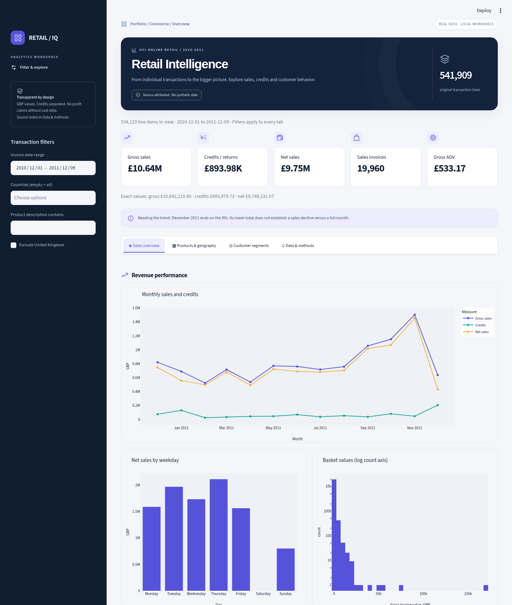

# Retail Intelligence: real transaction analysis

[](LICENSE)


Analyze UK online-retail sales, credit notes, products, countries and customer behavior, with an interactive local dashboard.

شرح مختصر بالمصري في [EXPLAIN_AR.md](EXPLAIN_AR.md).

## Dataset, questions and method

**Data:** full UCI Online Retail dataset, Chen (2015), 541,909 original line items, December 2010 to December 2011. UK retailer, currency GBP. Source: https://archive.ics.uci.edu/dataset/352/online . DOI: 10.24432/C5BW33. Data supplied under UCI CC BY 4.0 terms. Source archive was converted from XLSX to gzip CSV without row filtering. See `data/provenance.json` for download URL and original checksum. No synthetic rows.

**Questions:** How much positive sales value and credit value occurred? Which countries and products contribute most? How do invoice frequency and customer spend differ? Which observations are limited by missing customer IDs or partial months?

**Method:** remove 5,268 exact duplicate rows (an explicit assumption, not certainty); exclude zero quantity and nonpositive unit price. Keep all positive-price return lines and anonymous customers. Flag C-prefix invoices or negative quantities as credits. Do not deduplicate by invoice number: one invoice contains many products. Sales = positive non-credit line value; credits = absolute return-line value; net sales = sales minus credits. No cost data, so no profit calculation. SQL independently checks the country aggregation.

## Setup

Tested with Python 3.10.12. Use Python 3.10 or 3.11 and a fresh virtual environment.
Run the following **inside this project folder**:

```bash
python -m venv .venv
# Windows PowerShell:
.venv\Scripts\Activate.ps1
# macOS / Linux:
source .venv/bin/activate
python -m pip install -r requirements.txt
python main.py
```

Choose only the activation command for your operating system. If PowerShell blocks activation,
you can use `.venv\Scripts\python.exe` instead of `python` for each command.
All input data is included or comes bundled with scikit-learn; running requires no account,
API key, paid service or dataset download. Installing dependencies needs an internet connection.
The pinned requirements record the tested direct dependencies, not every transitive dependency.
All paths are relative to the script, so main.py also works when launched elsewhere.

## Repository map

- `main.py`: commented, reproducible analysis/training pipeline.
- `data/`: original data or dataset description and attribution.
- `outputs/`: actual generated reports, metrics, charts and run log.
- `EXPLAIN_AR.md`: short Egyptian-Arabic walkthrough and interview prompts.
- `requirements.txt`: tested direct package versions.

Results below are from the included reproducible run, not invented targets.

## Interactive dashboard

```bash
python -m streamlit run dashboard.py
```

Open the localhost URL shown in your terminal. Use `--server.port 8502` for a second app.
The ZIP is a local runnable project, not an already hosted dashboard.

- Date-range, country, exclude-UK and product-text filters.
- KPI cards for gross sales, credits, net sales, sales invoice count and gross AOV.
- Monthly trends, weekday totals, basket-value histogram with log counts.
- Top-N product/country rankings with selectable sales/credit/net measures.
- RFM-style customer summary, frequency/spend scatter and CSV export.
- Data-quality audit, line-item preview and filtered CSV export.
- Plotly hover, legend toggles, zoom and chart-image downloads.

Customer segments are transparent rules, not a trained model: repeat = 3+ invoices; recent repeat also has recency <=30 days. Recency uses selected end date plus one day. A product filter means matching-product value per matching invoice, not full-basket AOV. Credits in the window can belong to older sales; credit/sales value ratio is not an order-return rate. December 2011 is partial. No forecast or causal business claim is made.

## Reproduced results

### Online Retail findings

- Raw lines: 541,909; analyzed lines: 534,129.
- Gross sales: GBP 10,642,110.80; credits: GBP 893,979.73.
- Net sales: GBP 9,748,131.07 across 19,960 sales invoices.
- Gross average order value: GBP 533.17.
- Top net-sales country: United Kingdom.

These are transaction values, not profit: there is no cost-of-goods data.
Credits in this date window can relate to earlier purchases, so credits divided by sales
is a value ratio, not an order-return probability. Missing CustomerID does not mean zero sales;
those lines remain in revenue totals and are excluded only from customer-specific analysis.
Exact duplicate lines are removed under a stated ingestion-cleaning assumption, although
some identical lines could be legitimate repeated purchases. No invoice-level deduplication.
The final month ends on 9 December 2011, so it is not comparable with a full month.
Data are historical UK transactions in GBP, not current Egyptian market data.


## Tests and next steps

The downloadable five-project review bundle contains the integration test suite. This standalone repository can be verified with `python main.py` and its saved report. To rerun only this project: `python main.py`.

Before presenting this as your own work, understand each cleaning choice, explain every metric, and add a change you can defend. This is a ready-to-study portfolio starter, not a claim of client work or original data collection.

## Visual design

A dedicated `design.py` supplies inline SVG icons (no CDN), a dark filter sidebar,
source-attributed hero, metric cards, consistent Plotly styling and hover/fade transitions.
Animations respect `prefers-reduced-motion`. Commerce uses indigo/teal; ecology uses teal/amber/violet.
The interface is polished without inventing business outcomes or work experience.

## Bundled data and reports

Real datasets and generated reports are compressed in the root `5-project-assets.zip` file.
`resources.py` verifies its SHA-256 and extracts it automatically the first time you run
`main.py` or the dashboard. No web request is made. A numeric prefix on the archive filename
is harmless and supported. You can also run `python resources.py` explicitly before browsing
the output images locally. Saved joblib models are not published; run main.py to train them.
The full data-source notes and original notices remain inside the archive.

## Project preview


